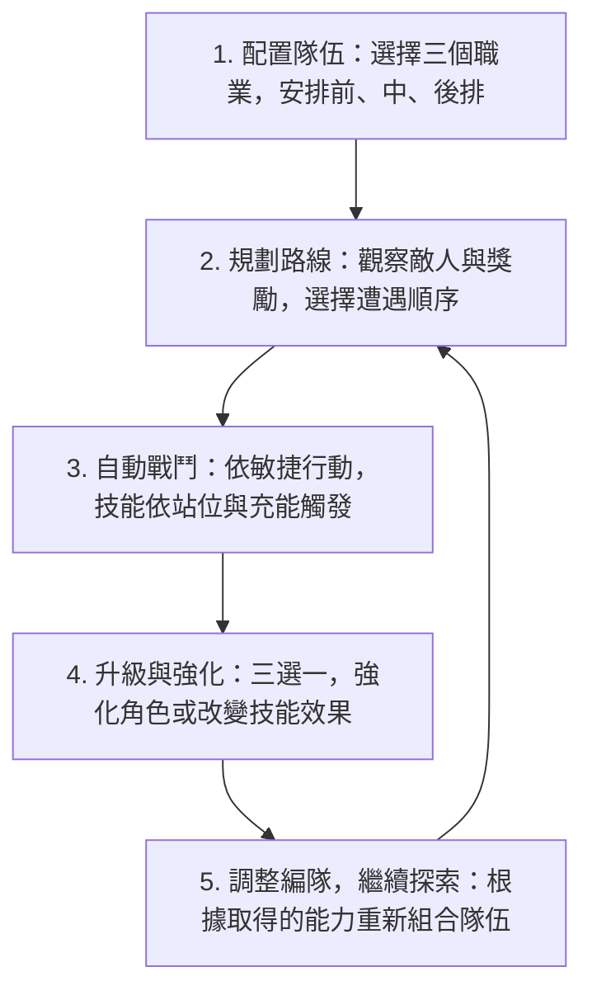

# Positional Dynamics — 遊戲流程與成長系統建議（完整討論存檔）

> 本文保留本次討論提出的完整建議、職業技能示例、升級三選一、路線規劃、第一版規模及站位調整選項。文中新增的機制皆屬**建議**，尚非已確認規格。原有設定另見 [GAME_DESIGN.md](./GAME_DESIGN.md)。

我會建議把 **Positional Dynamics** 設計成一款「編隊策略 × 自動戰鬥 × 路線規劃 × Roguelite 成長」的遊戲。

但我認為最值得發展的地方，不是單純讓角色升級、數值變強，而是讓玩家透過**職業、站位、技能充能與升級選擇，逐漸建立出一套能自動運作的戰鬥系統**。

這樣玩家雖然不需要在戰鬥中操作，卻仍然有很多值得思考的決策。

## 一、我建議的核心遊戲循環



關鍵在於：**升級不只影響戰鬥強度，也會讓玩家重新思考角色應該放在哪一排。**

## 二、職業設計：每個角色有六種技能狀態

每個職業有三個站位，每個站位有一般技能與充能技能，因此一個職業最多可以設計六種技能效果。

例如先做四種職業：

### 騎士 — 防禦與反擊
- 前排：格擋／全隊護盾
- 中排：突刺／貫穿攻擊
- 後排：守護／替隊友承受致命傷

### 祭司 — 治療與支援
- 前排：自身防禦／全隊防禦
- 中排：治療前排／完全治療
- 後排：持續恢復／復活隊友

### 遊俠 — 速度與連擊
- 前排：閃避攻擊／反擊連射
- 中排：雙重射擊／多重射擊
- 後排：精準狙擊／穿透狙擊

### 法師 — 範圍與控制
- 前排：魔法護甲／反射傷害
- 中排：火球／範圍爆炸
- 後排：冰凍／全體冰封

這裡我刻意讓同一職業在不同站位能扮演不同角色。例如騎士不一定只能當坦克，放在中排也可以成為攻擊手。

這會讓隊伍組合更有深度。

## 三、升級系統：我建議讓玩家升級「技能」，而不只是角色等級

我最推薦的是混合式成長：

- **角色等級**：提高生命、攻擊、防禦、敏捷等基本能力。
- **技能進化**：透過升級三選一，改變某個站位技能的效果。
- **隊伍強化**：偶爾提供全隊共享的被動效果。

例如祭司升級時，玩家可以從以下三種能力選一個：

| 技能進化 | 站位 | 效果 | 編隊意義 |
|---|---|---|---|
| 神聖屏障 | 前排進化 | 前排一般防禦額外替中排吸收部分傷害。 | 祭司在前排的保護價值提高。 |
| 生命共鳴 | 中排進化 | 中排治療時，額外恢復後排少量生命。 | 祭司在中排能兼顧兩個位置。 |
| 輪迴祈禱 | 後排進化 | 後排充能技能可復活一名倒下的隊友。 | 祭司在後排成為高價值的復活支援。 |

這樣一來，玩家可能一開始把祭司放在中排補血，但取得「輪迴祈禱」之後，就想把祭司移到後排。

**升級本身就會創造新的編隊策略。**

## 四、我會特別加入「充能」作為隊伍策略核心

建議不要讓每個角色單純每隔三回合就放一次大招。

可以讓不同職業有不同的充能條件，例如：

| 職業 | 充能條件 |
|---|---|
| 騎士 | 每次成功格擋獲得充能 |
| 祭司 | 每次治療隊友獲得充能 |
| 遊俠 | 每次攻擊命中獲得充能 |
| 法師 | 每次施放法術獲得充能 |

如此一來，玩家要思考的不只是誰比較強，而是**哪種隊伍能讓彼此更快充能**。

例如騎士格擋保護隊伍，祭司治療騎士，兩人持續累積充能，形成防禦與恢復的循環。

不過我建議第一個原型先採用簡單規則：充能達到 3 點就施放強化技能，施放後歸零。等基本戰鬥有趣了，再加入不同職業的特殊充能條件。

## 五、地圖移動應該如何影響角色成長？

我認為你的地圖系統可以是整款遊戲最特別的地方。

玩家不只是選擇路線，而是透過路線決定隊伍的成長方向。

例如：

```text
                       ⚔ 敵人
                     ╱         ╲
起點 ────────────────            ★ ──── ⚔ 敵人 ──── 終點
                     ╲         ╱
                       ✦ 探索             ✚ 恢復
```

- **上方路線：戰鬥** — 更多敵人、更多經驗與技能升級機會。
- **下方路線：探索** — 較少戰鬥，但可取得資源或恢復生命。

我建議讓玩家在選路線前，能大致知道敵人類型及獎勵，這樣路線規劃才是真正的策略，而不是碰運氣。

## 六、第一個可玩版本應該做多大？

我不建議一開始就設計十幾個職業，因為每個職業都有六種技能狀態，平衡成本會很高。

第一版可以控制在：

| 項目 | 第一版規模 |
|---|---|
| 職業 | 4 種 |
| 編隊 | 前、中、後排共 3 格 |
| 每職業技能 | 3 個一般 + 3 個充能 |
| 基礎技能總數 | 24 個 |
| 技能進化 | 每職業先做 3 種 |
| 敵人類型 | 5 種 |
| 地圖 | 1 張、約 8–12 個節點 |
| 單局時間 | 10–15 分鐘 |

這個規模已經足以驗證最重要的問題：玩家是否會因為不同升級結果而願意重新調整編隊。

## 七、還有一個重要的設計決策

我認為我們應該先決定：**玩家在一場探索過程中，能不能隨時調整角色站位？**

### A. 隨時可以換位
自由度最高，但可能讓每場戰鬥的準備變得繁瑣。

### B. 只能在戰鬥之間換位（我推薦）
戰鬥時保持自動，戰後依照升級與下一場敵人調整策略。

### C. 整張地圖只能配置一次
更重視長期規劃，考驗一套編隊能否應對所有遭遇。

我會優先推薦 **B：戰鬥之間可以重新編隊**。它能把你最有特色的兩個系統——站位技能與三選一升級——連結起來，讓每次成長都可能改變下一場戰鬥的策略。

---

**視覺示意**：請開啟 [可瀏覽的設計建議頁](./design-notes.html)，其中包含流程圖、四職業圖像化卡片、可點選的升級三選一、分支地圖，以及換位規則選項。原對話的非固定外部角色概念圖未直接複製，改用可持續保存的內嵌向量圖示。
